<p align="center">
  
</p>
<h1 align="center">MyMovieList</h1>
<p align="center"><strong>Your films. Your thoughts. Your space.</strong></p>
<p align="center">A personal movie library with discovery, personal recommendations, interactive cinema statistics and a private journal. No account or API key required.</p>
<p align="center"><a href="https://github.com/keremakcn/MyMovieList/releases/latest"><strong>Download</strong></a> · <a href="https://github.com/keremakcn/MyMovieList/releases">All releases</a></p>

**English** | [Türkçe](README.tr.md)

**Version 4.0.0 — Obsidian Screening Room:** a full-bleed cinematic redesign across Windows, Android and Web featuring three library views (**Editorial**, **3D Spatial Shelf**, **Poster Wall**), rotating living backdrops from your favorited or `8+` rated films, interactive **Cinema Stats** (`/stats`) with clickable poster drilldowns, monthly wave charts, crystal genre radar, director/actor portraits and cached studio logos, curatorial **For You** screening cards, frameless **Explore** posters, edge-to-edge movie detail pages, and automatic **>40-character note auto-save**.

## Get started

Windows and Android `4.0.0` release packages build directly from this source. macOS packages build from the same shared `4.0.0` source.

**Windows — v4.0.0**

1. Download `MyMovieList-v4.0.0-windows.zip` from the release’s **Assets**.
2. Extract it and open `MyMovieList-v4.0.0.exe`. No Python installation is needed.
3. Search for a film and add it to your library. Discovery is ready without setup.

**Android — 4.0.0 beta.1**

Download `MyMovieList-4.0.0-android-beta.1.apk` from the release’s **Assets** (or upload the matching `.aab` to Google Play) and open it on your phone. Android 7.0 or newer, a 64-bit ARM device and a current Android System WebView are required. The Android app runs independently, keeps your library on the phone and can sync your account library with Windows and Web when you sign in. Accounts remain optional. See [Android details](ANDROID.md).

**macOS — v4.0.0 beta**

Requires macOS 15 or later. Choose the `arm64` DMG for Apple Silicon (M-series) or `x86_64` for Intel, open it and drag MyMovieList to **Applications**. Version `4.0.0` includes the full Obsidian Screening Room UI, interactive Cinema Stats, Letterboxd/IMDb import, automatic note auto-save, favorite actors/directors, time-aware sync and packaged HTTPS certificates. Its DMGs build through the macOS workflow from this release source. These betas are not notarized by Apple. See [Mac build and installation details](MACOS.md).

## Web

[Use on the web](https://myshelf.cloud) — web PWA.

The MyShelf web app supports the same account and private library as the native apps: per-entry IndexedDB storage, offline PWA support, automatic sync, email-first signup, profile avatars, selected showcases, dynamic Open Graph cards and automatic long-note saving. Source and deployment details are in [WEB.md](WEB.md).

Per-field edit timestamps travel across web, Windows, Android and macOS so newer competing edits win, independent changes merge cleanly, and legacy conflicts stay recoverable.

## Features

- **Three cinema-grade library modes (`Editorial → 3D Shelf → Posters`):** browse your collection as full-bleed widescreen cinema scenes (**Editorial**), physical hardcover poster spines that unfold into full-bleed spreads (**3D Shelf**), or a frameless 2:3 gallery wall (**Poster Wall**).
- **Living Library Backdrop:** every visit illuminates your library and stats pages with a rotating full-screen scene drawn from your own favorited (`♥`) or `8+` rated films.
- **Interactive Cinema Stats (`/stats`):** explore your year in film with a clickable 53-week watch heatmap (with live day-title preview), smooth monthly wave chart, weekday equalizer meters, a 6-axis luminous crystal genre radar, a 10-tier rating ladder, 35mm decade filmstrips with real mini posters, 2×2 runtime cards, TMDB director/actor portraits, cached studio logos, a frosted-glass **Screening Inspector** poster modal for every chart element, and an on-device **1080×1350 Shareable Cinema Passport PNG** (zero private notes included).
- **Full-Bleed Movie Details & Automatic Note Auto-Save:** unified edge-to-edge film backdrops with frosted navigation chrome, inline 1–10 quick rating, side-by-side **Private Critic Vault** & **Synopsis**, and silent automatic saving for personal notes longer than 40 characters.
- **Letterboxd & IMDb Import:** bring `.zip` or `.csv` exports from Letterboxd or IMDb into your local vault in **Settings** while preserving existing ratings and personal notes.
- **Explore & Curatorial For You Recommendations:** browse trending, top-rated, new releases and genre portals as frameless poster walls, and dial between three personal discovery frequencies (**Close to my taste**, **A little discovery**, **Surprise me**) displayed as ranked festival screening cards.
- **Filmmaker & Studio Discovery + Favorite People:** explore actors, directors and production companies through portrait cards and career timelines, and keep private collections of favorite actors and directors.
- **Social:** find public profiles by name or username, open chosen showcases inside the app, and browse this week’s dated watches from selected showcase films. Private notes and the rest of your library stay private.
- **English and Turkish interface:** first launch follows your device's UI language (Turkish or English fallback), then remembers your choice locally (**Settings → Language**).
- **Instant Command Palette:** press **Ctrl+K** (**⌘K** on Mac) anywhere to search films, switch library modes or jump between views.

## Screenshots

Screenshots were captured directly from **v4.0.0** using a demo library and live public catalog data. [View the Turkish interface](README.tr.md#ekran-görüntüleri).

### Your library — Editorial, 3D Shelf & Poster Wall


<details>
<summary>3D Spatial Shelf and frameless Poster Wall modes</summary>

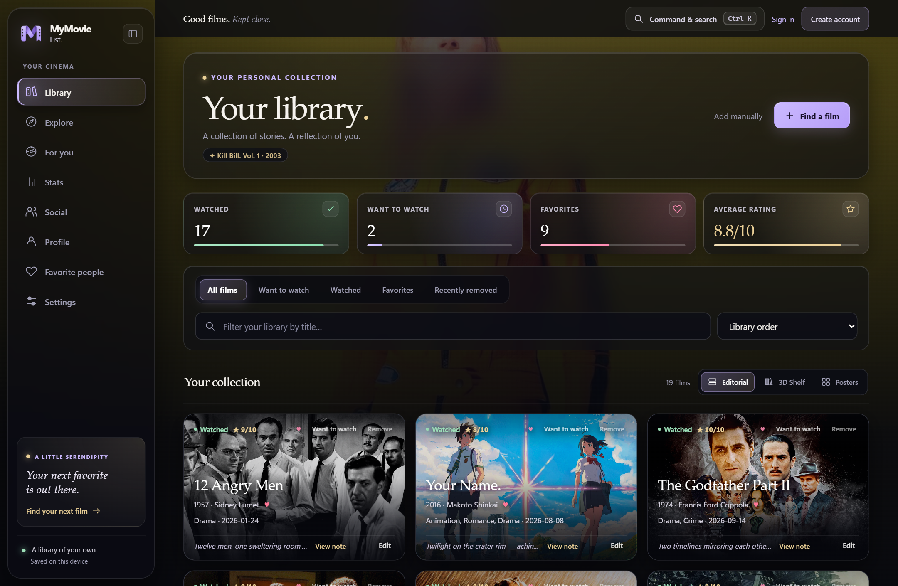


</details>

### Interactive Cinema Stats

Every day on the heatmap, every wave node, radar vertex, rating tier, decade filmstrip and runtime card opens a poster-grid Screening Inspector — calculated locally with zero private notes exposed.

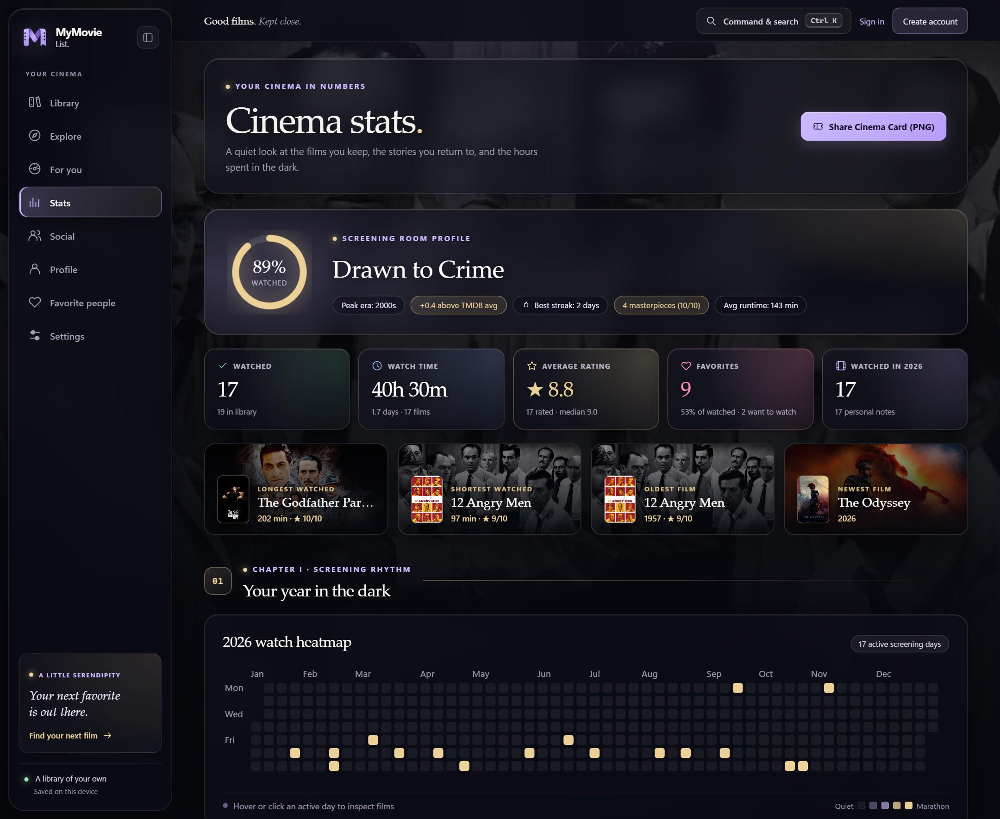

<details>
<summary>Genre Constellation Radar, 10-tier Rating Ladder, Portraits & Studio Logos</summary>

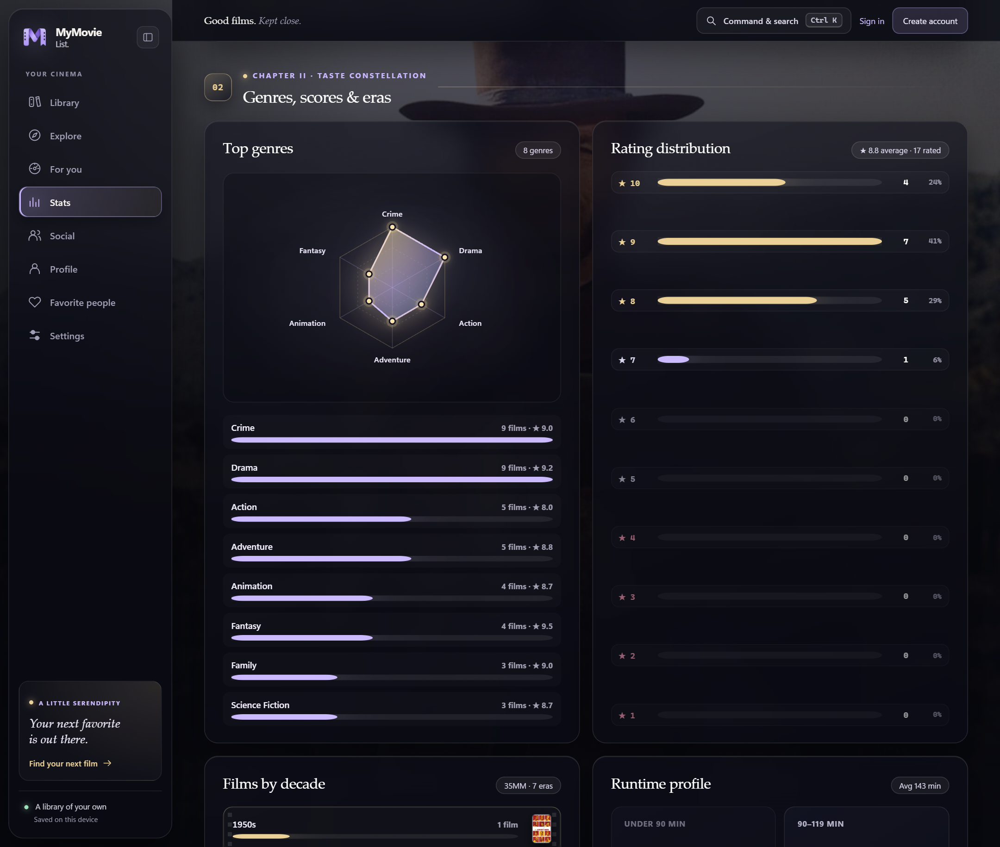

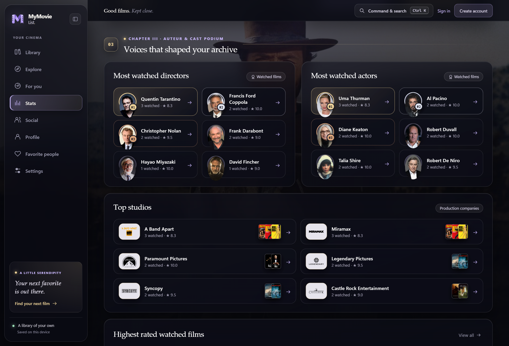

</details>

### Full-bleed movie details & private critic vault

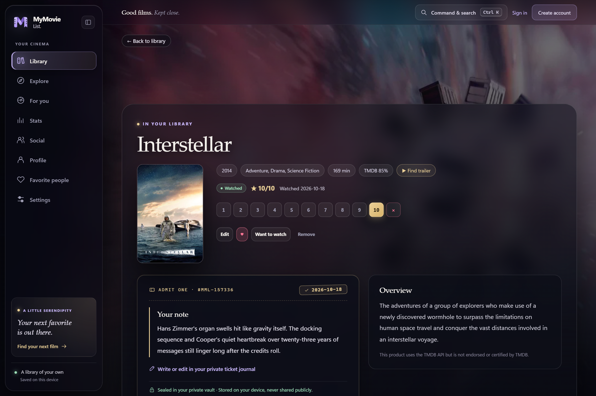

### Explore & personal recommendations

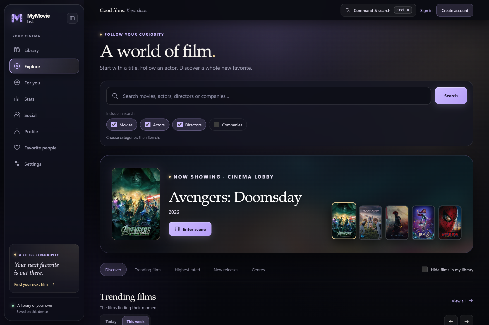

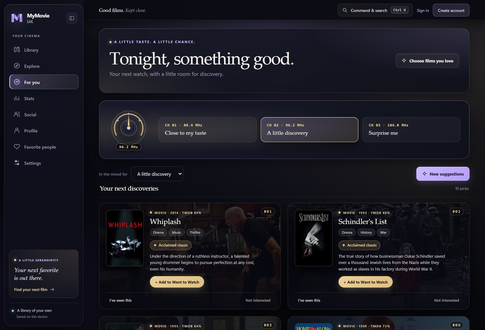

<details>
<summary>Filmmaker profiles, Social and optional account flows</summary>

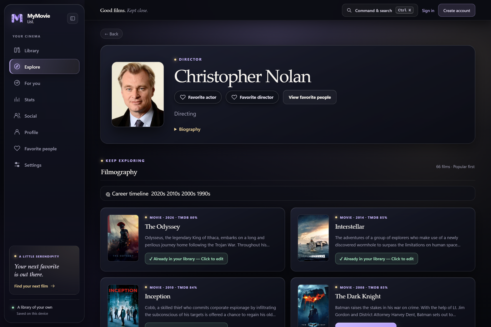

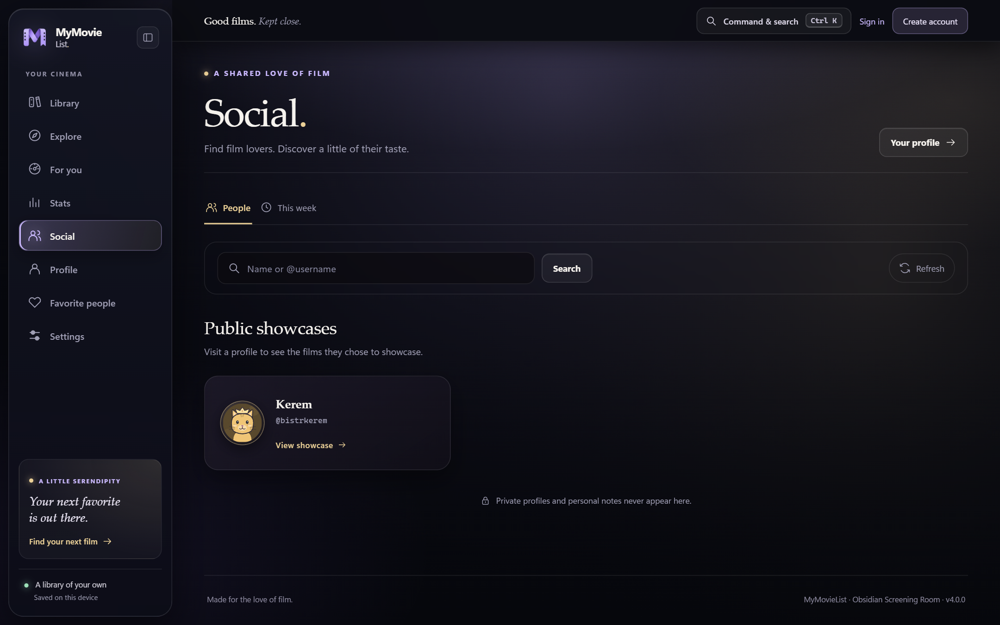

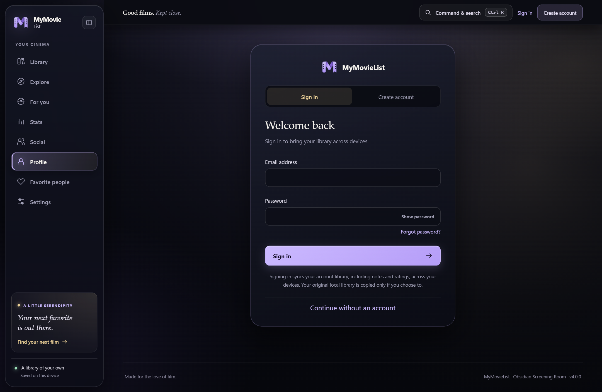

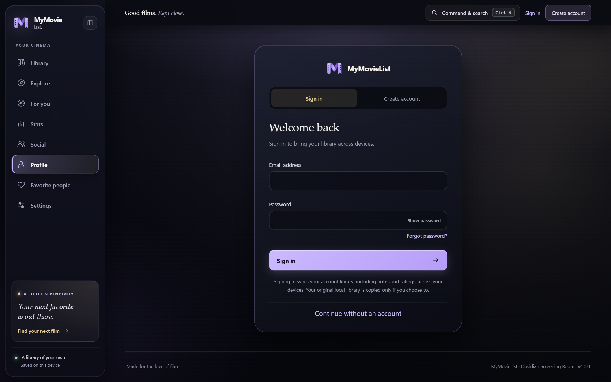

</details>

<details>
<summary>Phone layouts: library, explore, recommendations and stats</summary>

Responsive views of the shared v4.0.0 interface at phone size (`390×844`) with the floating bottom dock.

<p align="center">
  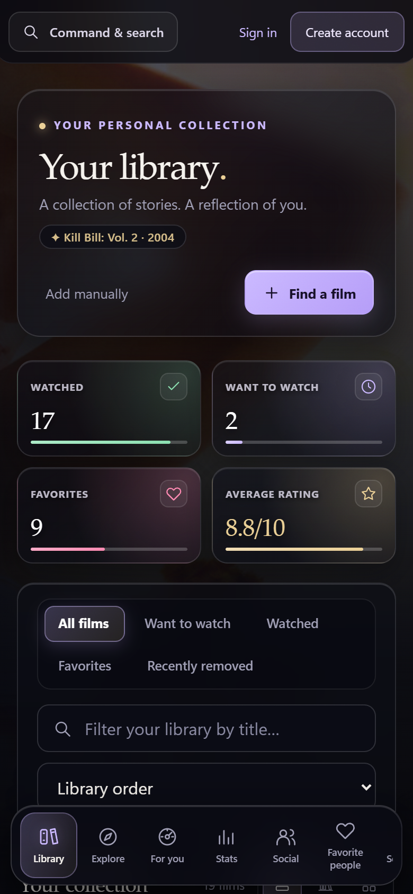
  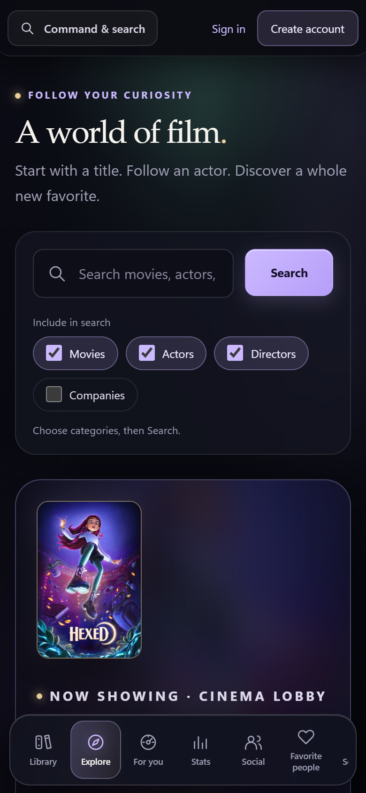
</p>
<p align="center">
  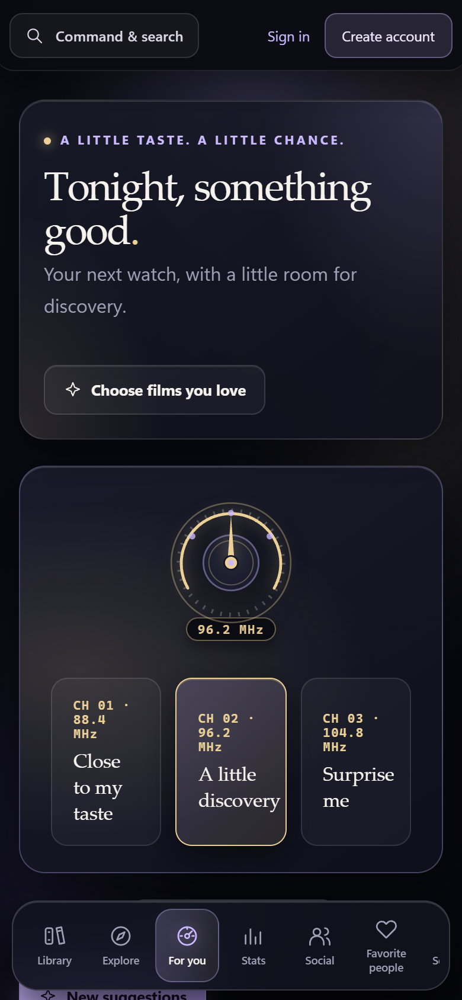
  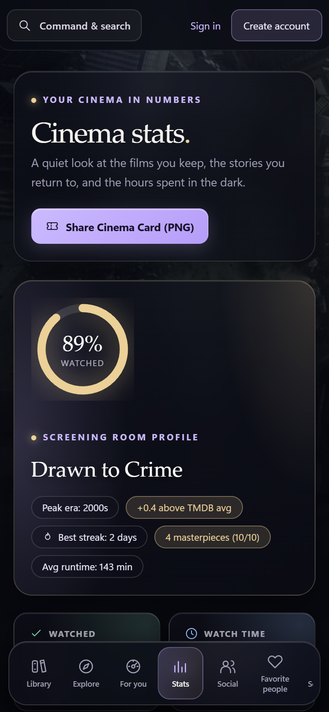
</p>

</details>

## Optional accounts and your profile

Keep using MyMovieList without an account, or sign in to take your private library across devices.

- **Automatic sync:** your ratings, notes, favorites and watch status save locally first, then sync when connected. No manual Sync button is needed. You can pause sync; pending edits remain on your device.
- **Keep your films when registering:** creating a new account automatically copies the films already saved on this device, with their notes, ratings, favorites and added order. The registration screen explains this before you finish. Your original local copy stays on the device.
- **Separate libraries:** signing in to an existing account opens that account's library. You can copy the original local library from account settings; existing account records keep their notes and ratings.
- **Simple registration:** email → verification code → unique username → password. Normal sign-in uses email and password; password recovery verifies its code before asking for a new password.
- **Your identity:** choose a display name and one of 16 bundled cat avatars. Display names may repeat. Your unique `@username` is visible on your profile, is chosen once and cannot currently be changed.
- **Your showcase:** select and order up to six films yourself. Sharing is off by default. When you enable it, your address is `myshelf.cloud/u/<username>`. Only your chosen films are shared; displaying ratings and library counts is also optional.
- **Private notes:** film notes, email, custom films and the rest of your library never appear on public profile pages or shareable stats cards.

## Your thoughts stay yours

Not every reaction needs an audience. Write honestly without publishing your notes to a public profile. Your library, notes, ratings and favorites are saved on your device and are not uploaded to our discovery service or TMDB. If you use an optional account, your account library also syncs privately through Supabase.

Recommendations and cinema statistics are computed on your device. Private notes are never analyzed or exported into stats cards.

Searches and catalog requests pass through `api.myshelf.cloud` to TMDB. Discovery and remote images need internet; saved library information and downloaded posters remain available offline. Local storage is not encrypted.

**Mac updates preserve your library** in `~/Library/Application Support/MyMovieList`. Close the app before replacing it in Applications.

**Updates preserve your Windows library.** Close the app before replacing the EXE. Existing data remains in `%APPDATA%\MovieWatchlist`; the original folder name is retained for compatibility. Android data stays in private app storage; installing the signed update over the existing app preserves your library.

## Run from source

Python 3.12 recommended:

```powershell
python -m venv .venv
.\.venv\Scripts\python -m pip install -r requirements-desktop.txt
.\.venv\Scripts\python run_desktop.py
```

Build Windows with `.\scripts\build_release.ps1` and Android with `.\scripts\build_android.ps1 -Release`. See [release notes](RELEASE_NOTES.md), [QA results](QA_RESULTS.md), [recommendation design](RECOMMENDATIONS_DESIGN.md), [discovery design](DISCOVERY_DESIGN.md), [Android build instructions](ANDROID.md) and [discovery service setup](cloudflare/watchlist-api/README.md) for development details.

Developers: see [cloud setup](supabase/README.md) and [data portability](CLOUD_SYNC_DESIGN.md). Database migrations `001–008` enable accounts, Social and scale indexes. See [Social design and validation](SOCIAL_DESIGN.md).

## Credits

Movie data and images are provided by [TMDB](https://www.themoviedb.org). This product uses the TMDB API but is not endorsed or certified by TMDB.
